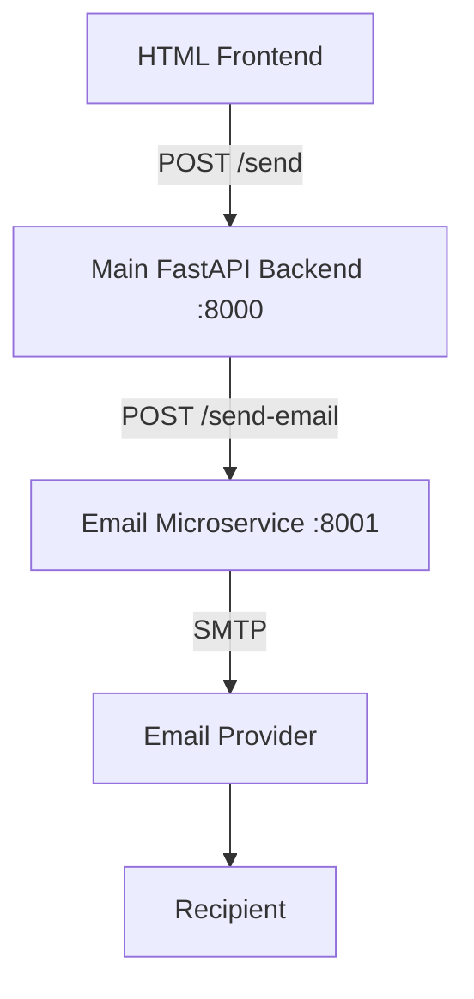

# Simple Email Microservice Application

## 1. What this is
A small, working demo of a **microservice architecture**. A plain HTML form calls a **Main FastAPI backend**. That backend never sends email itself: it calls a separate **Email Microservice** over REST, and the Email Microservice talks to an SMTP provider.

run command:

/Documents/projects/microservice/backend$ cd ~/Documents/projects/microservice/backend
source .venv/bin/activate
uvicorn app.main:app --host 127.0.0.1 --port 8000

~/Documents/projects/microservice/email-service$ cd ~/Documents/projects/microservice/email-service
source .venv/bin/activate
uvicorn app.main:app --host 127.0.0.1 --port 8001


## 2. Architecture



| Component | Responsibility |
|---|---|
| Frontend | UI, client-side validation, calls the Main Backend only, shows results |
| Main Backend | Validation, application logic, calls the Email Microservice, handles service errors, serves the frontend |
| Email Microservice | Email validation, SMTP connection, sending, SMTP error handling |
| SMTP provider | Actual delivery |

Details: [docs/ARCHITECTURE.md](docs/ARCHITECTURE.md)

## 3. Technologies
- Frontend: HTML, CSS, vanilla JavaScript (`fetch`)
- Backends: Python 3.12, FastAPI, Pydantic v2, Uvicorn
- Service-to-service calls: `httpx.AsyncClient`
- Email: Python standard library `smtplib` / `email.message`
- Tests: `pytest`, FastAPI `TestClient`, `httpx.MockTransport`

## 4. Project structure
```text
.
├── frontend/              index.html, style.css, app.js  (served by the backend)
├── backend/               Main Backend (:8000)
│   ├── app/
│   │   ├── main.py        app factory, lifespan httpx client, CORS, static frontend
│   │   ├── config.py      env settings (EMAIL_SERVICE_URL, ...)
│   │   ├── dependencies.py get_http_client (overridden in tests)
│   │   ├── errors.py      uniform error responses
│   │   ├── utils.py       mask_email for logs
│   │   ├── routes/        health.py, send.py
│   │   ├── schemas/       email.py
│   │   └── services/      email_client.py  (calls the Email Microservice)
│   ├── tests/
│   ├── requirements.txt
│   └── .env.example
├── email-service/         Email Microservice (:8001)
│   ├── app/
│   │   ├── main.py
│   │   ├── config.py      env settings (SMTP_*)
│   │   ├── errors.py      uniform error responses
│   │   ├── utils.py       mask_email for logs
│   │   ├── routes/        health.py, email.py
│   │   ├── schemas/       email.py
│   │   └── services/      smtp_sender.py
│   ├── tests/
│   ├── requirements.txt
│   └── .env.example
├── docs/                  IMPLEMENTATION_PLAN, ARCHITECTURE, API, SETUP, TESTING
└── README.md
```

## 5. Request flow
```text
Browser form ──POST /send {to, subject, message}──▶ Main Backend :8000
   Main Backend validates, then ──POST /send-email {to, subject, body}──▶ Email Microservice :8001
      Email Microservice validates, builds the MIME message, then STARTTLS + login + send ──▶ SMTP ──▶ Recipient
   ◀── 200 {"success": true, "message": "Email sent successfully"}
◀── 200 {"success": true, ...}   →  page shows "✓ Email sent successfully"
```

## 6. Install
```bash
cd email-service && python3 -m venv .venv && .venv/bin/pip install -r requirements.txt && cd ..
cd backend       && python3 -m venv .venv && .venv/bin/pip install -r requirements.txt && cd ..
```

## 7. Configure SMTP
```bash
cp email-service/.env.example email-service/.env   # fill in SMTP_* values
cp backend/.env.example backend/.env               # defaults work locally
```
Gmail: `SMTP_HOST=smtp.gmail.com`, `SMTP_PORT=587`, `SMTP_USERNAME`/`SMTP_FROM` = your address, and `SMTP_PASSWORD` = a 16-character **App Password**. Gmail usually requires an App Password when 2-Step Verification is on; create one at <https://myaccount.google.com/apppasswords>. Never commit `.env`. See [docs/SETUP.md](docs/SETUP.md).

## 8. Run
```bash
# Terminal 1
cd email-service
source .venv/bin/activate
uvicorn app.main:app --host 127.0.0.1 --port 8001

# Terminal 2
cd backend
source .venv/bin/activate
uvicorn app.main:app --host 127.0.0.1 --port 8000
```
Open **http://localhost:8000**.

## 9. API endpoints
| Service | Method | Path | Purpose |
|---|---|---|---|
| Main Backend | POST | `/send` | `{to, subject, message}` → send via the Email Microservice |
| Main Backend | GET | `/health` | `{"status":"healthy"}` |
| Main Backend | GET | `/` | Frontend |
| Email Microservice | POST | `/send-email` | `{to, subject, body}` → send via SMTP |
| Email Microservice | GET | `/health` | `{"status":"healthy"}` (no SMTP call) |

Status codes and failure cases: [docs/API.md](docs/API.md)

## 10. Testing
```bash
cd email-service && .venv/bin/python -m pytest -v
cd backend       && .venv/bin/python -m pytest -v
```
Unit tests mock SMTP and the service-to-service HTTP call, so no real email is sent. See [docs/TESTING.md](docs/TESTING.md).

**Latest results (2026-10-08):**
- Email Microservice: **19 passed**
- Main Backend: **17 passed**
- Live checks with both services running: health, frontend served at `/`, 422 validation, 503 (email service stopped), 504 (email service hanging, 2s timeout), CORS allow/deny. All behaved as documented.
- Real end-to-end through Gmail SMTP: `POST /send` returned `200 {"success":true}` in about 4.3s. Both services logged every hop, with the recipient masked.

## 11. Common errors
| Message | Fix |
|---|---|
| Email service is unavailable | Start the Email Microservice and check `EMAIL_SERVICE_URL` |
| Email service timed out | The SMTP server is slow or unreachable. Check the network and `SMTP_TIMEOUT` < `EMAIL_SERVICE_TIMEOUT` |
| Email provider authentication failed | Wrong SMTP credentials. For Gmail, use an App Password |
| Email service is not configured | `email-service/.env` is missing or has empty `SMTP_*` values |
| Could not connect to email provider | Wrong host or port, or `SMTP_USE_SSL` doesn't match the port (465 = SSL, 587 = STARTTLS) |
| Backend unavailable (in the page) | The Main Backend isn't running on :8000 |

## 12. Future improvements
- Service-to-service authentication (shared API key header or mTLS) so only the Main Backend can call the Email Microservice
- Asynchronous sending through a queue with retries, if volume grows
- HTML email templates and attachments
- Rate limiting on `/send` to prevent abuse
- Health checks that report dependency status (`/health/ready`)
- Structured (JSON) logs with request IDs propagated between services
- Containerization (Docker Compose) for one-command startup
# microservice-email
