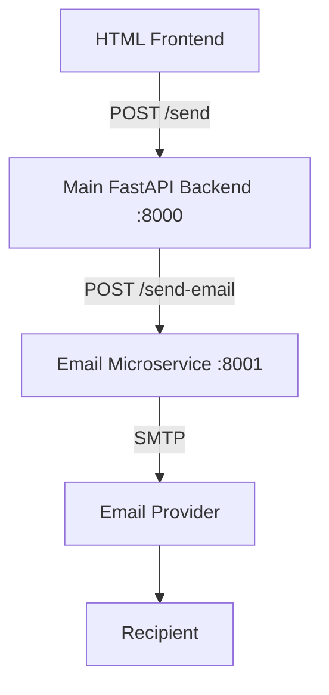

# Architecture

## Overview

```text
HTML/CSS/JavaScript Frontend
            |
            | HTTP  (POST /send, same origin)
            v
Main FastAPI Backend          :8000
            |
            | REST API  (POST /send-email)
            v
Email Microservice            :8001
            |
            | SMTP (STARTTLS :587 or SSL :465)
            v
Email Provider (e.g. Gmail)
            |
            v
Recipient
```



## Components and responsibilities

### Frontend (`frontend/`)
Plain HTML, CSS and vanilla JavaScript, served as static files **by the Main Backend** at `http://localhost:8000/`.
- Provides the user interface (To, Subject, Message, *Send Email* button).
- Collects the email information and validates it client-side for fast feedback.
- Calls **only** the Main Backend (`fetch('/send')`, a same-origin relative URL).
- Displays results: success, sending failed, validation errors, backend unavailable.
- Has **no** SMTP credentials and **no** knowledge of the Email Microservice.

### Main Backend (`backend/`)
FastAPI + Pydantic + httpx.
- Owns the application-facing API (`POST /send`, `GET /health`) and serves the frontend.
- Validates incoming requests (Pydantic, `EmailStr`, length limits, no line breaks in the subject).
- Translates the application request (`message`) into the Email Microservice contract (`body`).
- Calls the Email Microservice with a shared `httpx.AsyncClient`. The base URL comes from `EMAIL_SERVICE_URL` and there is an explicit timeout.
- Handles service errors: unreachable → 503, timeout → 504, error response → 502, unexpected → 500.
- Contains **no SMTP code**.

### Email Microservice (`email-service/`)
FastAPI + Pydantic + Python's standard `smtplib`.
- Owns everything email-related (`POST /send-email`, `GET /health`).
- Validates the email request independently. It never trusts its caller blindly.
- Builds the MIME message, connects to SMTP (STARTTLS or SSL), authenticates, and sends.
- Maps SMTP problems to clean HTTP responses (config 500, connection 503, auth 502, recipient refused 400, send failure 502). Internal details are logged, not returned.
- Reads SMTP credentials **only** from environment variables (`.env`, which is not committed).

### SMTP Provider
Does the actual delivery (for example, Gmail at `smtp.gmail.com:587`). It is outside this project.

## Request flow (happy path)

1. The user fills in the form and clicks **Send Email**. `app.js` validates the input and POSTs `{to, subject, message}` to `/send`.
2. The Main Backend validates the request with Pydantic and logs "Send request received".
3. The Main Backend POSTs `{to, subject, body}` to `${EMAIL_SERVICE_URL}/send-email`.
4. The Email Microservice validates the request, builds the message, connects to SMTP, logs in and sends.
5. The Email Microservice returns `200 {"success": true, "message": "Email sent successfully"}`.
6. The Main Backend returns `200 {"success": true, "message": "Email sent successfully"}`.
7. The frontend shows **✓ Email sent successfully**.

## Design decisions

| Decision | Reason |
|---|---|
| Separate virtualenv per service | Each service is independently deployable with its own dependencies |
| Frontend served by the Main Backend | One URL to open, no `file://`, and the browser only ever talks to one origin |
| Sync `def` endpoint for `/send-email` | `smtplib` is blocking, so FastAPI runs sync endpoints in a threadpool and the event loop isn't blocked |
| One shared `httpx.AsyncClient` (lifespan) | Connection pooling. It is injected via a dependency so tests can swap in `httpx.MockTransport` |
| Backend timeout (20s) > SMTP timeout (10s) | The Email Microservice can report its own SMTP timeout before the backend gives up |
| Uniform error body `{success, message, errors?}` | The frontend handles every response the same way |
| Generic client messages, detailed logs | Internal SMTP errors are never shown to users |

## CORS
The frontend is served from the same origin as the API, so CORS isn't strictly needed. It is still configured explicitly for local development (for example, if the HTML is served from another dev server):
- The Main Backend allows the origins from `CORS_ORIGINS` (default `http://localhost:8000,http://127.0.0.1:8000`), the methods `GET, POST`, and the header `Content-Type`. There is no wildcard.
- The Email Microservice has **no CORS** at all. It is internal and must never be called by a browser.

## Security notes
- `.env` files are git-ignored. Only `.env.example` with placeholders is committed.
- SMTP credentials live only in `email-service/.env`. They are never in the frontend or the main backend.
- Input is validated at both service boundaries. CR/LF are rejected in the subject to prevent header injection.
- The HTTP client has explicit timeouts.
- Logs mask recipients (`c***@example.com`) and never contain passwords or message bodies.
- Both services bind to `127.0.0.1` in the documented run commands.
- **Future improvement:** service-to-service authentication (for example, a shared `X-Internal-API-Key` header or mTLS) so that only the Main Backend can call the Email Microservice.
